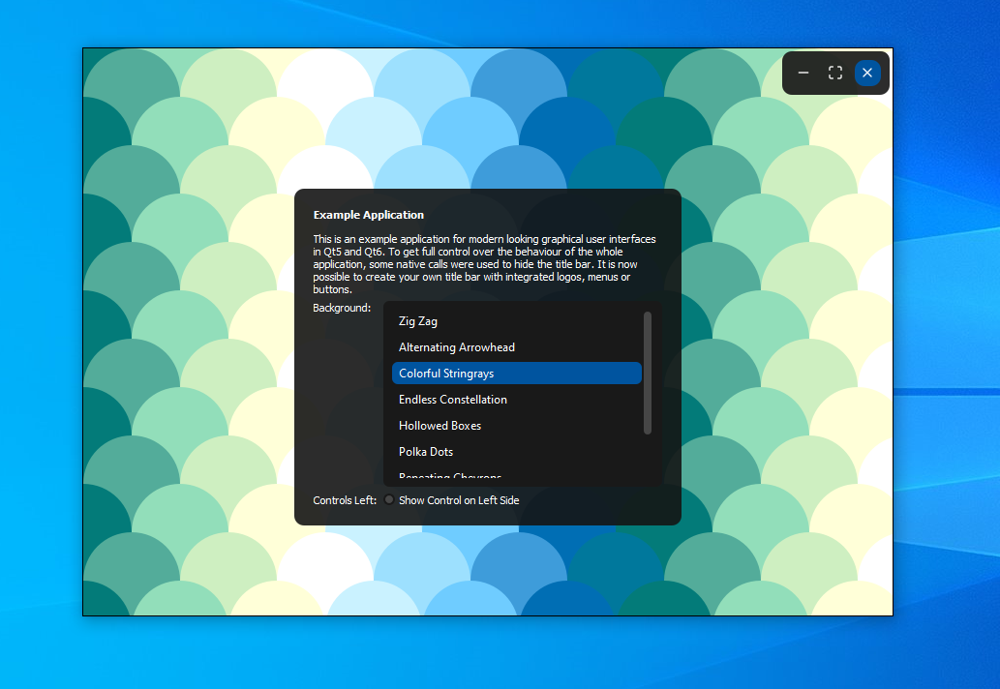

<div align="center">

# Qt Client Side Window Decorations

Draw your own title bar in Qt 6 and keep everything the operating system does with windows: snapping, tiling, native fullscreen, resizing and moving, on macOS, Windows and Linux.

<p>
  
  
  
  
  
</p>

<p>
  <a href="https://github.com/Foxei/QtClientSideWindowDecorations/actions/workflows/build.yml"></a>
</p>

<p>
  <a href="#features-at-a-glance">Features</a> •
  <a href="#how-it-works">How it works</a> •
  <a href="#use-the-library">Use the library</a> •
  <a href="#platform-capabilities">Capabilities</a> •
  <a href="#example-application">Example</a> •
  <a href="#getting-started">Getting started</a> •
  <a href="#configuration">Configuration</a> •
  <a href="#license">License</a>
</p>

</div>

<p align="center">
  
</p>

Custom title bars in Qt usually start with `Qt::FramelessWindowHint`, and that is where the trouble begins: Aero Snap stops working on Windows, the window no longer resizes like a native one, macOS fullscreen breaks, and every platform needs its own workaround. This library packages those workarounds behind one class.

Derive your main window from `UndecoratedWindow` instead of `QMainWindow`, put your content into the central widget, and style the title bar with a stylesheet. On each platform the library uses the native mechanism that keeps the window manager in charge of the window, so snapping, tiling, fullscreen and resizing behave exactly as users expect.

## Features at a glance

| Area | What you get |
| --- | --- |
| [Native window behaviour](#how-it-works) | Aero Snap and tiling on Windows, native fullscreen and traffic lights on macOS, system move and resize on Linux (X11 and Wayland) |
| [Custom title bar](#use-the-library) | Your own title bar widget with integrated logos, menus or buttons, styled with Qt stylesheets |
| [Control placement](#platform-capabilities) | Window controls on the left or right side, with a compile time flag that tells you what the platform supports |
| [Identical theming](#example-application) | The same look on every platform, with per-platform object names (`macos`, `windows`, `linux`) for fine tuning in stylesheets |
| [Window state](#use-the-library) | Window geometry and state are stored on close and restored on the next start |
| [CMake package](#install) | `cmake --install` plus `find_package(ClientSideWindowDecoration)`, or `add_subdirectory` |
| [Containerized builds](#option-1-docker-compose-all-platforms) | Linux, Windows and macOS builds from one `docker compose up`, nothing installed on the host |
| [CI and releases](#continuous-integration-and-releases) | GitHub Actions builds every platform, tests the CMake install, and publishes release packages for tags |

## How it works

<table>
  <tr>
    <td align="center"><br /><strong>macOS</strong></td>
    <td align="center"><br /><strong>Windows</strong></td>
    <td align="center"><br /><strong>Linux</strong></td>
  </tr>
</table>

### macOS

The window keeps its native frame. Objective-C++ code uses the Cocoa API to make the title bar transparent, extend the content below it and hide the window title, so the Qt content fills the whole window. The native traffic light buttons stay, because users expect them and they carry fullscreen, tiling and window menu behaviour. The library measures where macOS draws them and places the background of the controls exactly behind them. The calls are repeated on every window state change, including entering and leaving fullscreen.

### Windows

The Qt window is embedded in a native Win32 window that has a thick frame but no visible caption. Hit tests on the edges and the title bar area are forwarded to that native window, so Windows itself handles moving, resizing, Aero Snap, the system menu (<kbd>Alt</kbd>+<kbd>Space</kbd>) and the drop shadow. Minimize, maximize and close buttons in the custom title bar send the matching system commands.

### Linux

The window is frameless and uses Qt's `startSystemMove()` and `startSystemResize()`. The compositor moves and resizes the window, which works on X11 and Wayland and keeps edge tiling and snapping of the desktop environment. A translucent background allows rounded corners.

## Use the library

### Install

Build and install the library system wide (default prefix `/usr/local` on Linux and macOS):

```bash
cmake -S . -B build -DCMAKE_BUILD_TYPE=Release -DBUILD_EXAMPLE=OFF
cmake --build build
sudo cmake --install build
```

This installs the shared library, the headers and a CMake package configuration. Use `-DCMAKE_INSTALL_PREFIX=<path>` to install somewhere else.

### Add to your project

Import the installed library in the `CMakeLists.txt` of your application:

```cmake
find_package(ClientSideWindowDecoration 0.1 REQUIRED)
target_link_libraries(my_app PRIVATE ClientSideWindowDecoration::client_side_window_decoration)
```

Qt 6 Widgets is found automatically as a dependency. If the library was installed to a custom prefix, pass `-DCMAKE_PREFIX_PATH=<prefix>` when configuring your application. [`tests/install`](tests/install) contains a minimal application that does exactly this.

Alternatively add the repository as a subdirectory. The example application is not built in that case:

```cmake
add_subdirectory(QtClientSideWindowDecorations)
target_link_libraries(my_app PRIVATE ClientSideWindowDecoration::client_side_window_decoration)
```

### Write your window

Derive your main window from `UndecoratedWindow` instead of `QMainWindow` and add your widgets to the central widget. Do not load a second `QMainWindow` from a ui file.

```cpp
#include <client_side_window_decoration/UndecoratedWindow.h>

class MainWindow : public UndecoratedWindow {
  Q_OBJECT
 public:
  explicit MainWindow(QWidget *parent = nullptr) : UndecoratedWindow(parent) {
    centralWidget()->layout()->addWidget(new QLabel("Hello World"));
  }
};
```

The window stores its geometry and state with `QSettings` when it is closed. Set `QCoreApplication::setOrganizationName()` and `setApplicationName()` so every application gets its own settings.

### Style the title bar

The decoration consists of named widgets that can be styled with Qt stylesheets:

| Object name | Widget |
| --- | --- |
| `titleBarContainer` | The whole title bar |
| `controlsContainerRight` | The background behind the window controls |
| `minimizeBtn`, `maximizeBtn`, `closeBtn` | The custom window controls (Windows and Linux) |
| `macos`, `windows`, `linux` | The window itself, for platform specific rules |

```css
QWidget#controlsContainerRight {
    background-color: rgba(20, 20, 20, 0.9);
    border-radius: 10px;
}
```

## Platform capabilities

Not every feature is available on every platform. The library exposes compile time flags to check this:

| Flag | macOS | Windows | Linux | Description |
| --- | :---: | :---: | :---: | --- |
| `UndecoratedWindow::SUPPORTS_RIGHT_SIDE_CONTROLS` | ❌ | ✅ | ✅ | Window controls can be placed on the right side. macOS uses the native controls, which are always on the left. |

```cpp
if constexpr (UndecoratedWindow::SUPPORTS_RIGHT_SIDE_CONTROLS) {
  window->setTitleBarDirection(Qt::LeftToRight);  // controls on the right
}
```

Calling `setTitleBarDirection(Qt::LeftToRight)` on a platform without support is ignored with a warning.

## Example application

The [`example`](example) directory contains a demo application that shows what the library can do:

- Eight tiled backgrounds that run below the title bar, each with a matching accent color.
- A switch that moves the window controls between the left and the right side, disabled where the platform does not support it.
- A line for every capability flag of the library, so you can see at a glance what the current platform supports.
- A dark theme built from a palette and a stylesheet, identical on every platform.

The packaged example for every platform is attached to each [GitHub release](https://github.com/Foxei/QtClientSideWindowDecorations/releases).

## Getting started

Requirements for native builds: Qt 6.4 or newer (Widgets and Svg), CMake 3.16 or newer and a C++17 compiler.

### Option 1: Docker Compose (all platforms)

All platforms are built inside containers. Nothing besides Docker needs to be installed on the host.

```bash
docker compose up --build
```

| Platform | Toolchain | Output |
| --- | --- | --- |
| Linux | Ubuntu 24.04 with its Qt 6 packages | `dist/linux`, an install tree |
| Windows | Fedora MinGW-w64 cross compiler and Qt 6, x86_64 | `dist/windows/ExampleApplication` with all DLLs, plus a zip |
| macOS | [osxcross](https://github.com/tpoechtrager/osxcross) and the official Qt for macOS, universal arm64 and x86_64 | `dist/macos/Example Application.app`, ad-hoc signed, plus a tar.gz |

Build a single platform with `docker compose run --rm <linux|windows|macos>`. The macOS build needs the macOS SDK from the host, see [macOS SDK](#configuration).

### Option 2: Native build

```bash
cmake -S . -B build
cmake --build build
```

### Option 3: VS Code Dev Container

A `.devcontainer/` configuration based on the Linux build image is included, with CMake, Ninja, clangd and gdb.

1. Open the repository in VS Code.
2. Run `Dev Containers: Reopen in Container`.
3. The project is configured into `build/devcontainer` on creation. Build it with the CMake Tools extension.

### Test the install

```bash
docker compose run --rm linux /src/docker/linux/test-install.sh
```

This installs the library to `/usr/local` inside a throwaway container, then builds and runs [`tests/install`](tests/install) against it without any search paths.

### Continuous integration and releases

GitHub Actions builds every push and pull request for all three platforms. Linux and Windows use the same Docker Compose services as above and run the install test; macOS is built natively on a macOS runner and packaged with `macdeployqt`. Pushing a tag that starts with `v` (for example `v1.0.0`) creates a GitHub release with the packaged example application for every platform.

## Configuration

<details>
<summary><strong>CMake options</strong></summary>

| Option | Default | Description |
| --- | --- | --- |
| `BUILD_EXAMPLE` | `ON`, `OFF` as subproject | Build the example application. |
| `INSTALL_EXAMPLE` | `OFF` | Install the example application next to the library. |
| `CMAKE_INSTALL_PREFIX` | `/usr/local` | Where `cmake --install` puts the library. |

</details>

<details>
<summary><strong>macOS SDK for the Docker build</strong></summary>

Apple does not allow the macOS SDK to be redistributed, so the macOS build takes it from the host as a Docker build context. By default it uses the SDK of the Xcode command line tools at `/Library/Developer/CommandLineTools/SDKs/MacOSX15.4.sdk`.

On other hosts, point `MACOS_SDK_PATH` to an unpacked `MacOSX<version>.sdk` directory and set `MACOS_SDK_VERSION` to match, for example in a `.env` file next to `docker-compose.yml`:

```bash
MACOS_SDK_PATH=/path/to/MacOSX15.4.sdk
MACOS_SDK_VERSION=15.4
```

The Linux and Windows builds do not need the SDK.

</details>

<details>
<summary><strong>Runtime library lookup on macOS</strong></summary>

The library is referenced through the application's runtime search path (`@rpath`), which is how it is bundled inside an `.app`. Applications built in their own build tree find the installed library automatically. Applications that are installed or moved elsewhere should bundle the library in `Contents/Frameworks`, like the example does, or set their own `INSTALL_RPATH`.

</details>

## Stack

| Layer | Technologies |
| --- | --- |
| Library | C++17, Qt 6 Widgets and Svg, Cocoa (Objective-C++) on macOS, Win32 and DWM on Windows |
| Build | CMake 3.16+, Ninja, CMake package configuration with version file |
| Toolchains | GCC on Linux, MinGW-w64 for Windows, osxcross with clang for macOS, rcodesign for ad-hoc signing |
| Operations | Docker Compose, VS Code Dev Container, GitHub Actions with release publishing |

## Repository layout

```text
QtClientSideWindowDecorations/
├── library/                 # The library: UndecoratedWindow, native code per platform, title bar ui and styles
├── example/                 # Demo application with backgrounds, theming and capability overview
├── tests/install/           # Minimal external application that uses the installed library
├── docker/                  # Build images and scripts for Linux, Windows and macOS
├── documentation/images/    # Screenshots
├── .devcontainer/           # VS Code Dev Container
├── .github/workflows/       # CI: builds, install test, releases
└── docker-compose.yml       # Builds all platforms into dist/
```

## License

This library is licensed under the [GNU Lesser General Public License v3.0](COPYING.LESSER), which supplements the [GNU General Public License v3.0](COPYING). You can use it in proprietary applications as long as changes to the library itself are published under the same license and users can replace the library, for example by linking dynamically.
