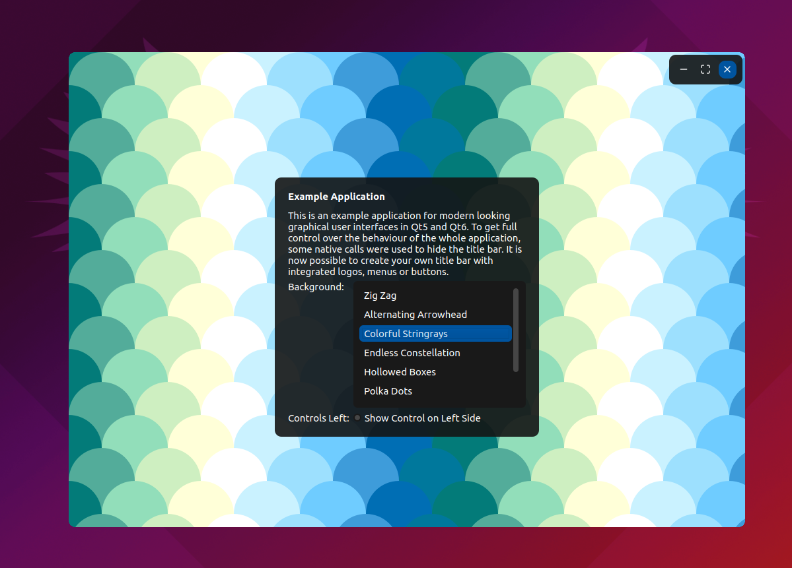

# QtClientSideWindowDecorationsExamples

This repository contains an example of how ClientSide window decorations can be implemented. The full feature set of the common desktop platforms is preserved. Previous methods often have problems with aero snap on windows or resizing on macos. In addition, identical theming accross all platforms is presented.

| Operating System | Supported Versions | Features | Preview |
| ------------- | ------------- | ------------- | ------------- |
| MacOs | Big Sur  | Tilling and fullscreen ✅   Save and restore window states ✅   Resize ✅   Move ✅ |  |
| Windows | 10  | Aero snap ✅   Save and restore window states ✅   Resize ✅   Move ✅  |  |
| Ubuntu | 22.04 Jammy Jellyfish | Gnome snapping ✅   Save and restore window states ✅   Resize ✅   Move ✅  |  |

### How?
I use native Objective-C code and the coca api, to hide the title bar. The calls are repeated for every window state change. 

### How?
I embed the QWindow in a native windows window. Corresponding system calls from the window decoration are forwarded. 

## How?
I use the startSystemResize and startSystemMove function from Qt 5.15 and a Qt::FramelessWindow.
