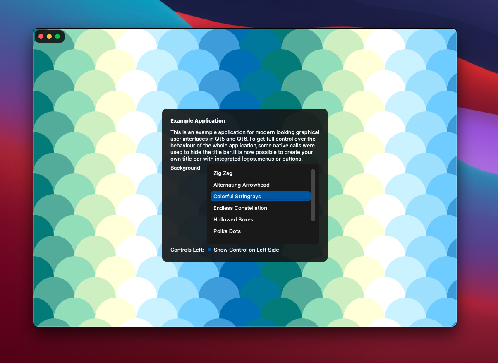

# QtClientSideWindowDecorationsExamples

This repository contains an example of how ClientSide window decorations can be implemented. The full feature set of the common desktop platforms is preserved. Previous methods often have problems with aero snap on windows or resizing on macos. In addition, identical theming accross all platforms is presented.

## Feature 

* Tilling, Snapping and Fullscreen ✅
* Save and restore window states ✅
* Resize ✅
* Move ✅

## Preview




## Install Example

The project supports CMake.

```bash
cd <project dir>
mkdir build
cd build
cmake ..
cmake --build .
```

## Use as Library

# Implementations Details

## MacOs
I use native Objective-C code and the coca api, to hide the title bar. The calls are repeated for every window state change. 

## Windows
I embed the QWindow in a native windows window. Corresponding system calls from the window decoration are forwarded. 

## Ubuntu
I use the startSystemResize and startSystemMove function from Qt 5.15 and a Qt::FramelessWindow.
